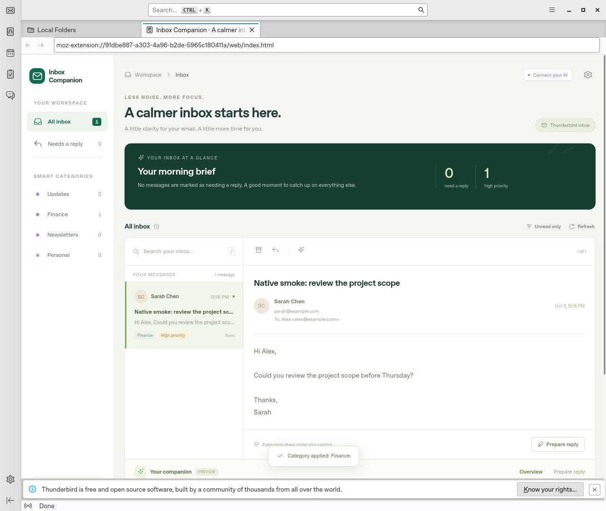

# Inbox Companion prototype downloads

[Download the complete prototype ZIP](https://github.com/J-WPD/Email/raw/refs/heads/codex/inbox-companion-downloads-20261012/Inbox-Companion-Prototype.zip)

The ZIP includes the Thunderbird add-on, both previews, the optional AI companion
source, and installation instructions. No credentials or private mailbox state
are included. These GitHub links are the delivery route; the original chat links
opened the cloud workspace viewer instead of downloading an attachment.

## Individual files

- [Thunderbird add-on](https://github.com/J-WPD/Email/raw/refs/heads/codex/inbox-companion-downloads-20261012/Inbox-Companion.xpi)
- [Thunderbird desktop preview](https://github.com/J-WPD/Email/raw/refs/heads/codex/inbox-companion-downloads-20261012/Thunderbird-preview.png)
- [Browser sample preview](https://github.com/J-WPD/Email/raw/refs/heads/codex/inbox-companion-downloads-20261012/Web-demo-preview.png)
- [Installation instructions](START-HERE.txt)
- [SHA-256 checksums](SHA256SUMS.txt)

If GitHub opens a ZIP/XPI file page, use its **Download raw file** arrow.
For a private repository, sign into GitHub with an account that has access.

## Install

Extract the ZIP. Keep the XPI as a single file. In Thunderbird 128 or later
(140 ESR recommended), open **Add-ons and Themes**, then select **Install Add-on
From File** from its gear/menu and choose `Inbox-Companion.xpi`.

The add-on uses your existing Thunderbird accounts. For optional AI, use Node.js
24 or later on the same computer. Open a terminal in the extracted `companion`
folder, run `npm ci` and `npm start`, and follow `START-HERE.txt` for pairing and
model configuration. Cloud-specific README paths should be replaced with your
own extracted companion folder.

## Validation and limits

Native workspace reading, rules, local categories, native tag preservation,
account-matched reply drafts, archiving, and local companion pairing passed in
Thunderbird 140 ESR with synthetic Local Folders mail. All 36 automated tests
passed. The native and browser previews show synthetic/sample messages.

Actual AI inference and real-provider account sync remain unverified. Configure
your chosen local Ollama model or optional provider key before using AI features.
This is a Thunderbird add-on prototype, not a rebranded Thunderbird distribution.
No sending or permanent deletion is automated.

## Native preview

